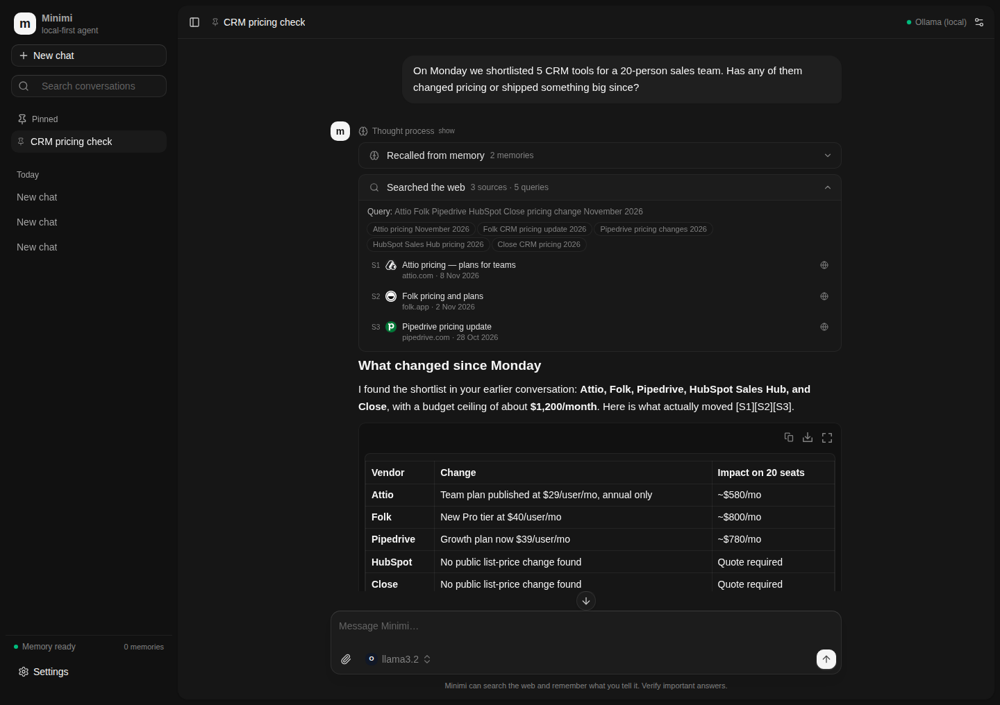

# Minimi

Minimi is a local-first research agent with web search, file reading, long-term memory, and a built-in Second Brain. It looks like a modern chat app, but every conversation, file, memory, and reminder stays in a SQLite database on your machine.



> The screenshot is generated from the running app. If it is missing, run `npm run dev` and take one.

## Why it exists

Most chat wrappers stop at "send the prompt to a model". Minimi is built around the questions that actually need an agent:

- "Has any of these five CRM tools changed pricing since Monday?"
- "What did I ask you on 3 November? Is your answer still correct today?"
- "Last Tuesday I asked you about Postgres hosting. Has any pricing changed since then?"

That means the agent has to recover earlier context, know what day it is, search the live web, read primary pages, cite sources, and say what changed instead of guessing.

## Features

- Streaming chat with markdown, tables, code blocks, reasoning, and tool-call cards.
- Live web search with query expansion, result deduplication, page extraction, publication-date detection, and numbered citations.
- Fetch any URL and read it as clean text.
- Long-term memory backed by local embeddings (`bge-small-en-v1.5`) and `sqlite-vec`, plus SQLite full-text search over every message.
- Memory extraction after each turn, date-aware recall, and a one-click rebuild from history.
- Second Brain reminders in a right-side notification drawer, with optional links and system notifications.
- File attachments: text, markdown, JSON, CSV, PDF, DOCX, and HTML are extracted and injected into the prompt.
- Multiple providers: OpenAI, Anthropic, Google, OpenRouter, Ollama, and any OpenAI-compatible endpoint.
- Local sessions with search, pinning, renaming, deleting, export, and import.
- Light, dark, and system themes.
- A thin Tauri desktop shell for Linux, macOS, and Windows.

## Quick start

Requirements: Node.js 20+ and npm. Optional: Ollama for a fully local model.

```bash
npm install
cp .env.example .env
npm run dev
```

Open <http://localhost:1420>. The API server runs on <http://127.0.0.1:8787> and Vite proxies `/api` to it.

You need at least one model provider:

1. Add a key to `.env` and restart, or
2. Open **Settings -> Providers** in the app, paste a key, enable the provider, and click **Test connection**, or
3. Install [Ollama](https://ollama.com), run `ollama pull llama3.2`, and leave the default Ollama provider enabled.

DuckDuckGo search works without any key. Tavily and Brave are optional. OpenRouter's default model is the free router, `openrouter/free`; Google defaults to `gemini-3.5-flash` because `gemini-2.5-flash` is retired for new API keys. Both can be changed in Settings or by editing the provider's default model.

## Scripts

| Command | What it does |
| --- | --- |
| `npm run dev` | Run the Node API and Vite together. This is the normal development command. |
| `npm run dev:server` | Run only the API with `tsx watch`. |
| `npm run dev:web` | Run only the Vite frontend. |
| `npm run build` | Type-check and build the frontend into `dist/`. |
| `npm start` | Run the API and serve the built frontend on port 8787. |
| `npm run tauri:dev` | Start the full stack and open the Tauri desktop window. |
| `npm run tauri build` | Build a desktop bundle. The API must be running separately. |

## API keys

All keys are optional individually, but you need one model provider.

| Variable | Used for | Required |
| --- | --- | --- |
| `OPENAI_API_KEY` | OpenAI models | One model provider |
| `ANTHROPIC_API_KEY` | Anthropic Claude models | One model provider |
| `GOOGLE_GENERATIVE_AI_API_KEY` | Google Gemini models (aliases: `GOOGLE_AI_STUDIO_KEY`, `GEMINI_API_KEY`, `GOOGLE_API_KEY`) | One model provider |
| `OPENROUTER_API_KEY` | OpenRouter models | One model provider |
| `BRAVE_API_KEY` | Brave web search | No |
| `TAVILY_API_KEY` | Tavily web search | No |

Ollama needs no key. Keys entered in the app are stored in the local SQLite database and are never sent anywhere except the provider you selected.

## Where data lives

By default:

- Linux: `~/.local/share/minimi`
- macOS: `~/Library/Application Support/minimi`
- Windows: `%APPDATA%/minimi`

Override with `MINIMI_DATA_DIR`. The folder contains `minimi.db`, extracted files, and the local embedding model cache.

Use **Settings -> Data** to export a JSON backup or delete all local data. Exports include conversations, messages, memories, reminders, settings, and provider metadata; API keys are never included. Reminders notify only while the app/server is running.

## Architecture

```text
┌──────────────────────────────┐        ┌──────────────────────────────┐
│ React 19 + Vite + Coss UI    │ /api   │ Hono on Node 20+             │
│ useChat + AI SDK UI stream   │◄──────►│ sessions, files, settings    │
│ Tauri webview (optional)     │        │ agent loop + tool execution  │
└──────────────────────────────┘        └──────────────┬───────────────┘
                                                       │
                                    ┌──────────────────┼──────────────────┐
                                    │                  │                  │
                              ┌─────▼─────┐     ┌──────▼──────┐    ┌──────▼──────┐
                              │ SQLite    │     │ Web search  │    │ Embeddings  │
                              │ + FTS5    │     │ DDG/Tavily  │    │ fastembed   │
                              │ + vec0    │     │ /Brave      │    │ + sqlite-vec│
                              └───────────┘     └─────────────┘    └─────────────┘
```

The full design, trade-offs, and open questions are in [DESIGN.md](DESIGN.md).

## Project layout

```text
server/
  index.ts          HTTP routes, streaming chat, import/export
  agent/            provider factory, system prompt, tools, agent loop
  search/           DuckDuckGo/Tavily/Brave, query expansion, page extraction
  db/               schema, migrations, DAOs
  reminders/        validation, scheduling, extraction, 30 s engine
  memory.ts         extraction, hybrid recall, rebuild
  embeddings.ts     local fastembed model
  file-store.ts     PDF/DOCX/text extraction
src/
  components/       chat, sidebar, settings, coss UI primitives
  lib/              API client, types, theme, formatting
src-tauri/          thin desktop shell
```

## Notes

- The default search provider is DuckDuckGo HTML, so no paid API is required.
- The embedding model is downloaded on first use (about 65 MB) and then cached locally.
- Timed reminders notify at the due time. All-day reminders notify every 2 hours from 09:00 to 21:00 local time. The scheduler checks every 30 seconds while Minimi is running. A missed nudge is still delivered the next time the app is open.
- Desktop notifications use the Tauri notification plugin; the browser falls back to the Notification API or an in-app toast. The notification drawer always updates.
- The API binds to `127.0.0.1` by default. CORS is restricted to the Vite dev origin and Tauri origins. Add extra origins with `MINIMI_ALLOWED_ORIGINS`.
